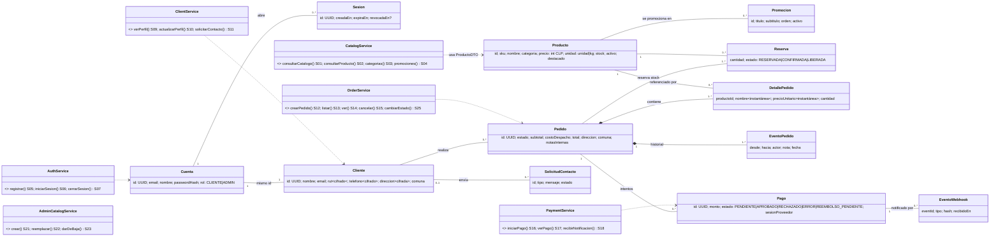
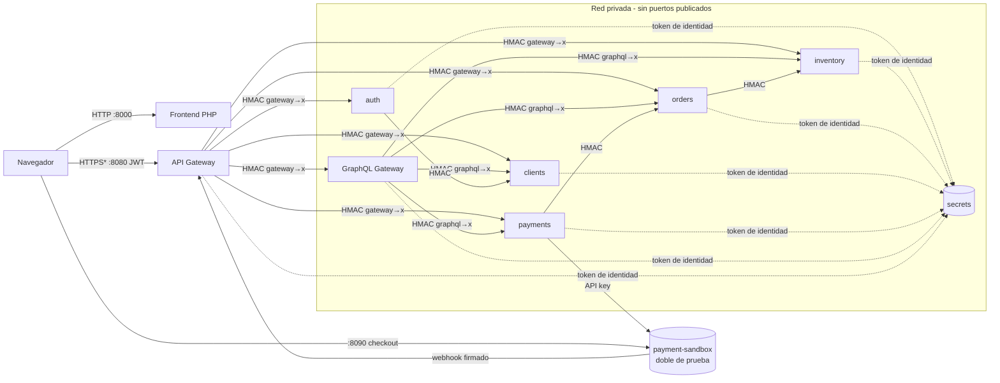
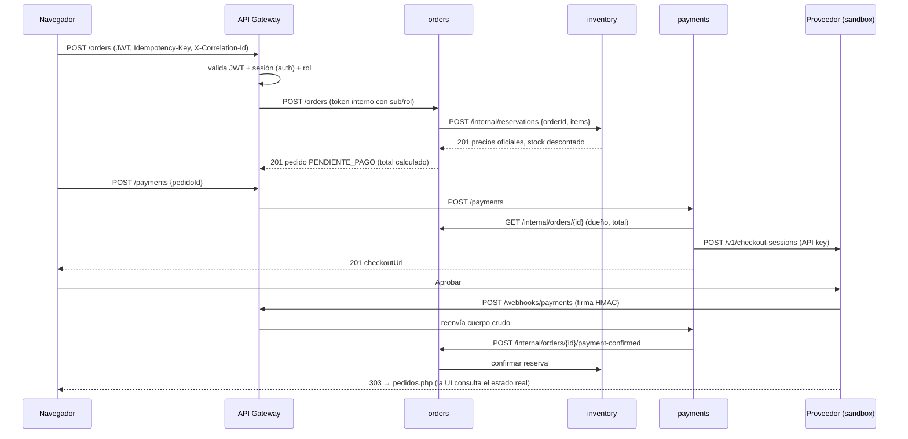
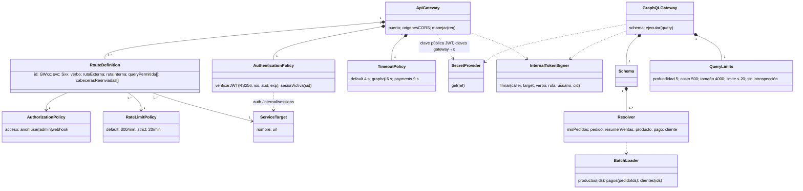

# Unidad 2 — Backend seguro completo · Chocolatería Chocomanía

**Caso:** tienda en línea de una chocolatería artesanal (catálogo, carrito, pedidos, pagos, órdenes especiales, administración).
**Integrantes:** Bruno Martínez (Sección 8481) — *completar*. **Versión del frontend:** 3.0.0 (`frontend/`), derivada del mockup `docs/diseno/mockup-chocolateria.jpeg`.
**Código:** `backend/` (servicios), `frontend/` (pantallas), `docker-compose.yml`, `tests/`.

## Requisitos del caso y brechas

| ID | Requisito (caso) | Pantalla(s) |
|---|---|---|
| R01 | Consultar catálogo, categorías y promociones | P-INI `index.php`, P-CAT `catalogo.php` |
| R02 | Registrarse e iniciar/cerrar sesión | modal de cuenta (todas) |
| R03 | Armar carrito y crear pedido con precios oficiales y stock | P-CAR `carrito.php` |
| R04 | Pagar el pedido con un proveedor de pagos | P-CAR, P-PED, pasarela del proveedor |
| R05 | Consultar mis pedidos y su estado de pago | P-PED `pedidos.php` |
| R06 | Cancelar un pedido pendiente | P-PED |
| R07 | Mantener perfil y datos de despacho | P-PER `perfil.php` |
| R08 | Solicitar órdenes especiales / contacto | P-CON `contacto.php` (CTA "¡Contáctanos!" del mockup) |
| R09 | Administrar productos y stock | P-ADM `admin.php` |
| R10 | Administrar estados de pedidos, ver solicitudes, clientes y resumen de ventas | P-ADM |
| R11 | Seguridad: autenticación, autorización por recurso, protección de datos y secretos | transversal |
| R12 | Resiliencia ante fallos de dependencias | transversal |
| R13 | Interfaz responsiva (móvil, tablet, escritorio) | todas |
| R14 | Despliegue reproducible con separación pública/privada | — |

Brechas del prototipo inicial (U1) resueltas en esta entrega: no existían carrito, pedidos, pagos, perfil ni administración; los datos venían de objetos `resAPI` locales. Las páginas `nosotros.php` y `servicios.php` muestran contenido informativo estático (`assets/data/*.json`): **decisión** — no son datos de negocio y no requieren backend.

---

## Módulo 1 — Servicios derivados del frontend

Ruta externa = `/api/v1` + ruta. Clasificación: **Pú** público · **Pe** personal/restringido · **Cr** credencial.

| ID | Req. | Pantalla → acción | Propósito | Verbo y ruta | Entrada | Salida | Reglas y errores | Datos | Acceso |
|---|---|---|---|---|---|---|---|---|---|
| S01 | R01 | P-INI/P-CAT → cargar productos, filtrar | Consultar catálogo | GET `/products?categoria&q&destacado` | query opcional (categoría ∈ lista, q ≤ 50) | 200 `{data:[{id,nombre,descripcion,categoria,precio,unidad,stock,disponible,imagen,destacado}],total}` | 400 filtro inválido; solo activos; sin sku/activo | Pú | anónimo |
| S02 | R01 | (detalle/carrito) | Consultar producto | GET `/products/{id}` | id | 200 producto | 404 inexistente o inactivo | Pú | anónimo |
| S03 | R01 | menú "Catálogo", chips | Categorías | GET `/categories` | — | 200 `[{nombre,total}]` | — | Pú | anónimo |
| S04 | R01 | P-INI → carrusel | Promociones | GET `/promotions` | — | 200 `[{id,titulo,subtitulo,productoId,precio,unidad,imagen,disponible}]` | solo activas | Pú | anónimo |
| S05 | R02 | modal → Crear cuenta | Registro | POST `/auth/register` | `{nombre(2-80), email, password(8-72, letras y números)}` | 201 `{id,email,nombre,role}` | 400 validación, 409 correo registrado | Pe, Cr | anónimo |
| S06 | R02 | modal → Ingresar | Login | POST `/auth/login` | `{email,password}` | 200 `{accessToken,expiresIn:900,user}` | 401 genérico, 423 bloqueo tras 5 fallos | Cr | anónimo |
| S07 | R02 | menú → Cerrar sesión | Revocar sesión | POST `/auth/logout` | — | 200 | 401 | Cr | autenticado |
| S08 | R02 | (diagnóstico) | Identidad actual | GET `/auth/me` | — | 200 `{id,email,nombre,role}` | 401 | Pe | autenticado |
| S09 | R07 | P-PER cargar / P-CAR prellenar | Ver perfil propio | GET `/me/profile` | — | 200 `{nombre,email,rut,telefono,direccion,comuna}` | solo el propio | Pe | autenticado |
| S10 | R07 | P-PER guardar | Actualizar perfil | PUT `/me/profile` | `{nombre, rut?, telefono?, direccion?, comuna?}` | 200 perfil | 400 RUT con DV inválido, formato | Pe | autenticado |
| S11 | R08 | P-CON enviar | Solicitud de contacto/orden especial | POST `/contact-requests` | `{nombre,email,tipo∈{CONSULTA,ORDEN_ESPECIAL},mensaje(10-1000)}` | 201 `{id,estado:NUEVA}` | 400; 429 límite | Pe | anónimo (o autenticado) |
| S12 | R03 | P-CAR confirmar | Crear pedido | POST `/orders` + `Idempotency-Key` | `{items:[{productId,cantidad 1-50}](1-20), despacho:{direccion,comuna}, notas?}` | 201 pedido; 200 + `idempotent-replay` si reintento | 409 STOCK_INSUFICIENTE, 422 producto no disponible/clave reutilizada, 503 inventario | Pe | CLIENTE |
| S13 | R05 | (API) | Listar mis pedidos | GET `/orders?limite&desde` | paginación ≤ 20 | 200 | solo propios | Pe | autenticado |
| S14 | R05 | (API) | Ver pedido | GET `/orders/{id}` | id | 200 | 404 si ajeno | Pe | propietario/ADMIN |
| S15 | R06 | P-PED cancelar | Cancelar pedido | POST `/orders/{id}/cancel` | — | 200 CANCELADO | 409 si no PENDIENTE_PAGO; 404 ajeno | Pe | propietario/ADMIN |
| S16 | R04 | P-CAR/P-PED pagar | Iniciar pago | POST `/payments` | `{pedidoId}` (monto **no** se acepta) | 201 `{id,monto,estado,checkoutUrl}` | 400 campo no permitido, 404 ajeno, 409 no pagable, 503 proveedor | Pe | propietario |
| S17 | R04 | (API) | Ver pago | GET `/payments/{id}` | id | 200 | 404 ajeno | Pe | propietario/ADMIN |
| S18 | R04 | — (proveedor) | Notificación del proveedor | POST `/webhooks/payments` | evento firmado `X-Sandbox-Signature` | 200 `{recibido,duplicado}` | 401 firma, 422 no coincide | Pe | identidad del proveedor |
| S19 | R05,R10 | P-PED, P-ADM resumen | Agregación GraphQL | POST `/graphql` | `{query, variables}` | 200 `{data, errors?}` | 400 límites; errores parciales tipificados | Pe | autenticado |
| S20–S23 | R09 | P-ADM productos | Listar/crear/reemplazar/dar de baja producto | GET/POST `/admin/products`, PUT/DELETE `/admin/products/{id}` | producto completo (PUT reemplaza) | 200/201 | 409 SKU duplicado; DELETE = baja lógica | Pú+interno | ADMIN |
| S24–S25 | R10 | P-ADM pedidos | Listar pedidos / cambiar estado | GET `/admin/orders?estado`, PUT `/admin/orders/{id}/status` | `{estado, nota?}` | 200 | 409 transición inválida, 422 PAGADO reservado a payments | Pe | ADMIN |
| S26 | R10 | P-ADM clientes | Listar clientes (enmascarado) | GET `/admin/clients` | — | 200 RUT/teléfono enmascarados | — | Pe | ADMIN |
| S27–S28 | R10 | P-ADM solicitudes | Listar / cambiar estado de solicitud | GET `/admin/contact-requests`, PUT `/admin/contact-requests/{id}` | `{estado}` | 200 | 404 | Pe | ADMIN |

Ejemplos JSON ficticios (de respuestas reales de las ejecuciones): ver `evidencias/RUN-03/P06/*-red.json` (POST /orders, POST /payments) y `evidencias/RUN-03/P12/*-red.json` (GraphQL). El navegador nunca envía precios, totales ni estados de pago confiables (P09).

## Módulo 2 — Clases y cardinalidades del dominio



| Origen | Destino | Multiplicidad | Regla que la origina |
|---|---|---|---|
| Pedido | DetallePedido | 1 — 1..* | un pedido confirmado contiene al menos un ítem (validación `items` 1..20); no se modelan borradores: el carrito es local |
| Pedido | EventoPedido | 1 — 1..* | todo pedido nace con el evento `→ PENDIENTE_PAGO`; la anulación agrega un evento, no borra |
| Producto | DetallePedido | 1 — 0..* | un producto puede no haberse vendido; el detalle guarda nombre y precio como instantánea, por lo que el historial no cambia si el producto se modifica o se da de baja (baja lógica) |
| Cliente | Pedido | 1 — 0..* | un pedido pertenece a un único cliente (propiedad verificada en orders) |
| Pedido | Pago | 1 — 0..* | puede haber intentos rechazados; a lo más un pago PENDIENTE vigente por pedido |
| Pago | EventoWebhook | 1 — 0..* | `eventId` único evita aplicar dos veces una notificación |
| Cuenta | Cliente | 1 — 1 | registro crea ambos con el mismo id; si clients falla, auth deshace la cuenta |
| Pedido | Reserva | 1 — 1..* | una reserva por producto del pedido, clave (pedido, producto) |

Carrito ≠ Pedido: el carrito es un borrador local `{productId, cantidad}` sin precios confiables; el Pedido existe solo al confirmarse en el servidor. Internamente se guardan `passwordHash`, `sku`, `activo`, `notasInternas`, `rut/telefono` cifrados; los DTO públicos excluyen esos campos (p. ej. S01 no devuelve `sku`/`activo`, verificado en P01).

## Módulo 3 — Sistemas e integraciones

| Sistema | Responsabilidad | Datos (autoridad) | Servicios | Dependencias | Contrato | Identidad | Ante fallos |
|---|---|---|---|---|---|---|---|
| inventory | catálogo, precio oficial, stock, reservas | products, promotions, reservations | S01–S04, S20–S23 | — | REST interno; `POST /internal/reservations` atómico e idempotente por pedido | HMAC por par (`internal/{gateway,graphql,orders}--inventory`) | si cae, orders no crea pedidos (503, sin efectos) |
| orders | ciclo de vida del pedido y transiciones | orders, order_items, order_events, idempotency_keys | S12–S15, S24–S25, reportes | inventory | reserva/confirmación/liberación; `payment-confirmed` solo desde payments | HMAC | reserva no confirmada → se libera preventivamente; idempotencia por clave |
| clients | perfil, datos personales cifrados, solicitudes | clients, contact_requests | S09–S11, S26–S28 | gestor de secretos (clave PII) | REST | HMAC + `clients/pii-encryption-key` | sin clave no arranca (falla cerrado) |
| payments | pagos y relación con el proveedor | payments, webhook_events | S16–S18 | orders, proveedor | checkout hospedado + webhook HMAC con marca de tiempo (±300 s) | `payments/provider-api-key`, `payments/webhook-signing-secret` | proveedor caído → 503, pedido sigue reservado; webhook sin orders → 503 para reintento del proveedor |
| auth | credenciales, sesiones, JWT | users, sessions | S05–S08 | clients (alta de perfil) | JWT RS256 (iss, aud, exp, sid) | `auth/jwt-signing-key` (solo auth) | si auth cae, el gateway no valida sesiones (503, falla cerrado) |
| graphql | agregación de lectura | ninguno | S19 | orders, inventory, payments, clients | GraphQL → REST interno con batching | HMAC | errores parciales con `completo=false` |
| secrets | custodia de secretos y ACL | store | — | — | `GET /v1/secrets/{ref}` con token de identidad | hash de identidad por consumidor | servicios reintentan con backoff y no arrancan sin secretos |
| payment-sandbox | **doble de prueba** del proveedor externo | sesiones en memoria | — | webhook al gateway | contrato tipo proveedor | API key + secreto de webhook | — |

Mapa de componentes y red:


\* En el entorno local se usa HTTP en loopback; en un despliegue real el gateway iría detrás de TLS (ver limitaciones).

Secuencia representativa (compra):



## Módulo 4 — Stakeholders y permisos HTTP

| Stakeholder | Interés | Rol | Uso de información |
|---|---|---|---|
| Visitante | conocer productos | anónimo | catálogo público, contacto |
| Cliente | comprar y seguir pedidos | CLIENTE | sus pedidos, pagos y perfil |
| Administración de la tienda | operar catálogo y pedidos | ADMIN | todos los pedidos, clientes (enmascarados), solicitudes, resumen |
| Dueña / gerencia | resultados del negocio | **sin permisos operativos** | recibe el resumen de ventas exportado por ADMIN |
| Repartidor | entregar | **sin permisos operativos** | ADMIN le entrega dirección y comuna del pedido despachado |
| Proveedor de pagos | notificar resultados | identidad técnica (firma webhook) | solo S18 |
| Servicios internos | colaborar | identidades técnicas `gateway`, `graphql`, `orders`, `payments`, `auth` | rutas `/internal/*` según par autorizado |

| Rol / identidad | Servicio | Ruta | Verbo | Decisión | Condición | Dónde se verifica |
|---|---|---|---|---|---|---|
| anónimo | S01–S04 | /products, /categories, /promotions | GET | permitido | campos públicos | gateway (lista blanca) + inventory (DTO) |
| anónimo | S05, S06, S11 | /auth/*, /contact-requests | POST | permitido | límite estricto por IP | gateway |
| anónimo | S12–S19 | /orders, /payments, /graphql | todos | **denegado (401)** | — | gateway |
| CLIENTE | S12 | /orders | POST | permitido | solo rol CLIENTE; precios desde inventory | gateway + orders |
| CLIENTE | S13–S15 | /orders, /orders/{id}, /cancel | GET/POST | permitido | **solo pedidos propios** (ajeno → 404) | orders |
| CLIENTE | S16–S17 | /payments | POST/GET | permitido | pedido propio y PENDIENTE_PAGO | payments (consulta a orders) |
| CLIENTE | S19 | /graphql | POST | permitido | `notasInternas`, `resumenVentas` → FORBIDDEN; pedido ajeno → null | graphql + orders/clients/payments |
| CLIENTE | S20–S28 | /admin/* | todos | **denegado (403)** | — | gateway + servicio (defensa en profundidad) |
| ADMIN | S20–S28 | /admin/* | GET/POST/PUT/DELETE | permitido | DELETE = baja lógica; PAGADO no asignable | gateway + inventory/orders/clients |
| ADMIN | S12 | /orders | POST | denegado (403) | la administración no compra | orders |
| proveedor | S18 | /webhooks/payments | POST | permitido | firma HMAC válida, ±300 s, evento no repetido, monto/sesión coinciden | payments |
| payments | — | orders /internal/orders/{id}/payment-confirmed | POST | permitido | solo caller `payments` | orders |

Ocultar botones no es control: P18 prueba los 403 directamente contra la API y la página `admin.php` además lo muestra.

## Módulo 5 — Clases del API Gateway

Se usa **un** API Gateway: el tráfico externo es pequeño y homogéneo; las rutas se separan por política (anónimo, autenticado, admin, webhook). Varios gateways no tendrían justificación concreta.



**Fronteras de confianza:** (1) Internet → gateway: nada del navegador es confiable; se descartan cabeceras de identidad (P19). (2) gateway → servicios: la identidad viaja en un token HMAC de 30 s ligado a emisor, destino, verbo y ruta; cada servicio lo verifica y además comprueba propiedad y reglas de negocio. (3) servicios → secretos: token de identidad por consumidor y ACL de mínimo privilegio.

- *Solicitud autorizada:* `GET /api/v1/orders/{id}` con JWT de A → gateway valida firma, exp y sesión → token interno `gateway→orders` con `sub=A` → orders verifica token y que `client_id = A` → 200.
- *Solicitud denegada:* mismo pedido con JWT de B → gateway autentica → orders detecta `client_id ≠ B` → 404 sin datos (P13).

Qué valida cada uno: gateway = identidad, rol grueso, ruta/verbo, tamaño, límites, tiempo; servicios = identidad de servicio, caller permitido, rol, **propiedad**, validación de datos, transiciones.

## Módulo 6 — Rutas y secretos de integración

Matriz de rutas completa en código: [`backend/services/gateway/routes.js`](../backend/services/gateway/routes.js) (GW01–GW28, cada una con `svc`, acceso, destino y query permitida). Extracto:

| ID | Verbo | Ruta externa | Acceso | Destino interno | Controles | Credencial del tramo |
|---|---|---|---|---|---|---|
| GW01 | GET | /api/v1/products | anónimo | inventory GET /products | query en lista blanca (categoria, q, destacado), 300/min | `internal/gateway--inventory` |
| GW06 | POST | /api/v1/auth/login | anónimo | auth POST /login | 20/min por IP, 32 KB, JSON | `internal/gateway--auth` |
| GW12 | POST | /api/v1/orders | CLIENTE | orders POST /orders | JWT+sesión, reenvía solo `Idempotency-Key` | `internal/gateway--orders` |
| GW16 | POST | /api/v1/payments | autenticado | payments POST /payments | timeout 9 s | `internal/gateway--payments` |
| GW18 | POST | /api/v1/webhooks/payments | webhook | payments POST /webhooks/provider | cuerpo crudo + `X-Sandbox-Signature` | `internal/gateway--payments` + firma del proveedor |
| GW19 | POST | /api/v1/graphql | autenticado | graphql POST /graphql | timeout 6 s, límites GraphQL | `internal/gateway--graphql` |
| GW23 | DELETE | /api/v1/admin/products/{id} | ADMIN | inventory DELETE /admin/products/{id} | rol verificado en gateway e inventory | `internal/gateway--inventory` |

GraphQL (schema: [`backend/services/graphql/schema.graphql`](../backend/services/graphql/schema.graphql)):

| Operación | Tipo | Campos autorizados | Resolver | Subsistemas |
|---|---|---|---|---|
| misPedidos(limite≤20, desde) | Query | pedidos propios; `notasInternas` solo ADMIN | Query.misPedidos + ResumenPedido.* | orders, inventory (batch), payments (batch), clients |
| pedido(id) | Query | propio o ADMIN; ajeno → null | Query.pedido | orders, inventory, payments, clients |
| resumenVentas(dias 1..365) | Query | solo ADMIN | Query.resumenVentas | orders (`/internal/reports/sales`) |

No hay mutations: crear, pagar y cancelar permanecen en los servicios REST (reglas transaccionales). gRPC: no aplica (ADR-001).

Inventario de secretos (valores generados por `init-secrets.js` en `.secrets/`, nunca en el repositorio):

| Referencia | Tipo | Emisor | Consumidor(es) | Finalidad | Ubicación | Alcance | Rotación / revocación |
|---|---|---|---|---|---|---|---|
| auth/jwt-signing-key | clave privada RSA 2048 | init-secrets | auth | firmar JWT | gestor de secretos | solo auth | nuevo par + publicar clave pública; sesiones vigentes caducan (15 min) |
| auth/jwt-public-key | clave pública | init-secrets | gateway | verificar JWT | gestor | lectura | junto con la privada |
| internal/{a}--{b} (13 pares) | HMAC 256 bits | init-secrets | a y b | identidad entre servicios | gestor | un par por relación | `rotate-secret.js <ref>` + reinicio de ambos; `--revoke` corta la relación |
| clients/pii-encryption-key | AES-256 | init-secrets | clients | cifrar RUT/teléfono/dirección | gestor | solo clients | requiere re-cifrado (procedimiento manual documentado) |
| payments/provider-api-key | API key `sk_test_` | proveedor (sandbox) | payments | crear sesiones de pago | gestor | solo payments | emitir nueva en el proveedor y actualizar |
| payments/webhook-signing-secret | HMAC | proveedor | payments | verificar notificaciones | gestor | solo payments | rotación coordinada con el proveedor |
| identities/{svc}.token | token de identidad | init-secrets | cada servicio | autenticarse ante el gestor | archivo montado (docker secret), el gestor guarda solo su SHA-256 | un consumidor | regenerar con `init-secrets --force` |

Si una clave se filtra: revocar (`rotate-secret.js ref --revoke`) y reiniciar consumidores. Si el gestor no responde: los servicios reintentan con backoff (8 intentos) y **no arrancan** sin secretos (falla cerrado); los que ya están en ejecución conservan los valores en memoria.

## Módulo 7 — Datos sensibles y secretos del cliente

| Dato / credencial | Finalidad | Clasificación | Custodio | Roles | Representación en frontend | Protección | Retención |
|---|---|---|---|---|---|---|---|
| Producto (nombre, precio, imagen) | catálogo | público | inventory | todos | tarjetas | — | mientras exista; baja lógica |
| Correo | identificación y contacto | personal | auth, clients | dueño, ADMIN | perfil, admin | solo autenticado; no en logs | vida de la cuenta |
| Nombre | despacho/saludo | personal | clients/auth | dueño, ADMIN | menú, pedidos | — | vida de la cuenta |
| RUT, teléfono | boleta / contacto de despacho | personal sensible (contexto) | clients | dueño; ADMIN enmascarado | perfil | **AES-256-GCM en reposo**, enmascarado en listados, redactado en logs | vida de la cuenta |
| Dirección de despacho | entrega | personal | clients (perfil, cifrada), orders (instantánea del pedido) | dueño, ADMIN | perfil, detalle | solo dueño/ADMIN; nunca en catálogo | pedido: obligación tributaria/garantía (definir plazo con la tienda) |
| Contraseña | autenticación | credencial | auth | nadie la lee | campo password | scrypt (N=2^15, sal 16 B), nunca se devuelve | hasta cambio |
| JWT de acceso | sesión | credencial | navegador (sessionStorage) | dueño | no visible | RS256, 15 min, revocable por sesión | 15 min |
| Notas internas | gestión | interno | orders | ADMIN | admin | autorización por campo GraphQL | con el pedido |
| Claves de integración | operación | secreto | gestor | servicios | **nunca** | ACL + mínimo privilegio | rotación |

**Decisión sobre secretos del cliente: NO** se custodian secretos asociados al cliente (no se almacenan tarjetas, tokens de pago ni claves de terceros del cliente). El pago ocurre en la pasarela del proveedor; Chocomanía solo guarda el resultado y el monto. Los datos personales son restringidos, pero no son "secretos".

Recorrido de un dato restringido (teléfono): captura en `perfil.php` (HTTPS en producción) → gateway (no lo registra) → clients valida formato → cifra con la clave PII → almacena `v1:iv:tag:dato` → se devuelve descifrado solo al dueño; ADMIN lo ve enmascarado → al eliminar la cuenta se borra la fila (procedimiento manual pendiente, ver riesgos U3).

Casos de validación propuestos y **ejecutados** (resultados en U3): anónimo a catálogo (P01), operación protegida sin sesión (P16), admin desde rol sin permiso (P18), pedido ajeno (P13), acceso directo al backend (P19), confirmar pago con datos alterados (P09, P11).

Revisión: no hay secretos en JavaScript/HTML (el frontend solo recibe `apiBase`); P29 busca automáticamente los valores secretos en todas las evidencias y logs de cada ejecución (0 coincidencias).

## Módulo 8 — Separación privada y agregaciones GraphQL

| Servicio | Naturaleza | Responsabilidad | Datos propios | Contrato | Dependencias | Justificación de separación |
|---|---|---|---|---|---|---|
| inventory | transaccional | catálogo y stock | products, reservations | REST | — | alta lectura pública; autoridad de precio; cambia por razones distintas a pedidos |
| orders | transaccional | pedidos | orders, items, eventos | REST | inventory | reglas de transición propias; consistencia con reservas |
| clients | transaccional (datos personales) | perfil | clients | REST | secrets | aislar PII y su clave de cifrado |
| payments | transaccional (integración externa) | pagos | payments, webhooks | REST + webhook | orders, proveedor | aislar credenciales del proveedor y la superficie de webhooks |
| auth | identidad | credenciales | users, sessions | REST + JWT | clients | aislar hashes y clave de firma |
| graphql | agregación | composición de lectura | ninguno | GraphQL | 4 servicios | evita que el navegador orqueste llamadas y que los servicios se expongan |
| secrets | soporte | custodia | store | REST interno | — | punto único auditado de secretos |

Agregación implementada: `misPedidos` / `pedido` combinan **orders** (estado, totales, ítems), **inventory** (ficha actual del producto, en lote), **payments** (último pago, en lote) y **clients** (titular). Se integra con la pantalla real `pedidos.php` a través de `POST /api/v1/graphql` (evidencia: `evidencias/RUN-03/P12`). Consulta de prueba y respuesta ficticia:

```graphql
query Pedido($id: ID!) { pedido(id: $id) { id estado total completo advertencias items { nombre cantidad producto { imagen disponible } } pago { estado monto } cliente { nombre } } }
```
```json
{ "data": { "pedido": { "id": "…", "estado": "PAGADO", "total": 29970, "completo": true, "advertencias": [],
  "items": [{ "nombre": "Bombones Surtidos (12 u.)", "cantidad": 2, "producto": { "imagen": "/assets/img/productos/bombones.svg", "disponible": true } }],
  "pago": { "estado": "APROBADO", "monto": 29970 }, "cliente": { "nombre": "Ana Pérez (ficticia)" } } } }
```

Si inventory no responde: `producto: null`, error `DEPENDENCY_UNAVAILABLE` con `path`, `completo: false` y advertencia; la pantalla muestra "Información parcial" (P15). Controles: identidad verificada por el gateway, autorización por recurso en los servicios dueños y por campo en resolvers, paginación ≤ 20, profundidad 5, costo 500, 4000 caracteres, sin introspección, 2 s por dependencia, batching por solicitud (P14). El navegador no puede invocar los subsistemas (P19).

## Módulo 9 — Analítica y gRPC

Ver [`docs/adr/ADR-001-analitica-grpc.md`](adr/ADR-001-analitica-grpc.md): no aplican; la alternativa (agregación en orders vía GraphQL `resumenVentas`) se midió en `evidencias/CARGA-01` y cumple el objetivo declarado.

## Módulo 10 — Backend completo e integración verificable

- Persistencia real: SQLite por servicio con migraciones (`services/*/migrations/*.sql`) y semillas ficticias; restauración con `reset-data.js`.
- Arranque/parada: `start-local.js` (verificado) o `docker compose up` (no verificado en este entorno). Health checks `GET /health` en cada servicio.
- Logs JSON con `X-Correlation-Id`, sin credenciales (redacción por nombre de campo) ni datos personales innecesarios.
- Pruebas: `tests/runner.mjs` (29 pruebas de contrato, integración E2E, reglas críticas y seguridad) y `tests/load/load-test.mjs`.
- Matriz requisito | pantalla | servicio | prueba | resultado | evidencia: [`docs/trazabilidad.csv`](trazabilidad.csv).
